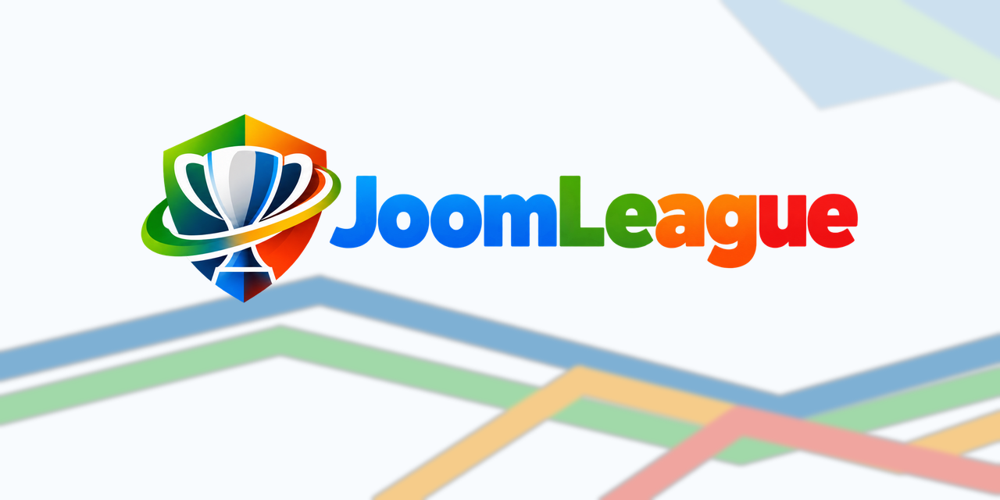

# JoomLeague

  

JoomLeague is a sport-neutral sports management extension for Joomla.

## Branding

For repository documentation:
- Repository banner: `banners/joomleague-github-1280x640.png`
- Full logo: `logos/joomleague-logo-standard-transparent.png`
- Small symbol: `developer/svg/joomleague-symbol-flat.svg`

For GitHub social preview, upload:
`social/joomleague-social-1200x630.png`

Do not introduce sport-specific imagery into repository branding.
